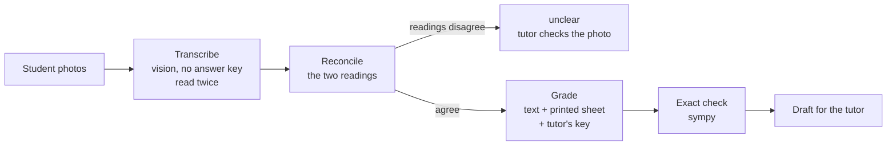

# TutorIlya Homework

**AI-assisted homework checking for a private maths tutor.** Students photograph
their handwritten homework; the app reads it, drafts a per-problem grade with an
explanation in the student's own language, checks the maths exactly where it
can, and hands the draft to the tutor, who reviews, edits and publishes.

Live at **[homework.tutorilya.com](https://homework.tutorilya.com)** and used by
real students (school maths on the Portuguese and Russian curricula, and
university calculus / analysis).

> Nothing the AI writes reaches a student until the tutor publishes it. The
> design goal is not "an AI that grades" but a draft the tutor can trust:
> when the system isn't sure, it says so instead of guessing.

---

## What it does

**For students** (English / Russian interface)
- See assigned homework with the printed task sheet, upload photos (phone
  photos, HEIC or PDF), resubmit until reviewed.
- A hint helper with two buttons - "remind me the theory" and "help with
  task N" - limited to 3 hints per assignment. It gives one next step, in the
  student's language and curriculum, and never the final answer.
- Feedback per problem once published, grade history and progress, in-app
  notifications.

**For the tutor**
- Inbox of submissions with the AI status (draft ready / flags to check / AI
  failed / checking).
- Review page: photos beside the AI's per-problem draft, one-tap verdicts,
  editable answers and explanations, flags for anything the AI was unsure
  about, "Recheck with AI" with notes on specific problems.
- Attach the homework sheet and the tutor's own answer key to an assignment;
  the AI then grades against the key instead of solving the problems itself.
- Student profiles with curriculum, school year and private notes; a progress
  page and a parent-ready PDF report with an AI-written summary.

## How the AI grading works

The core idea: **reading is kept separate from judging.** A model that sees the
answer key while reading a photo tends to "see" the right answer; a model that
grades straight from a photo can't be checked. So grading is a pipeline of
small, testable stages (`grading.py`):



1. **Transcribe** - a vision model copies what the student wrote, verbatim,
   from each page and from overlapping horizontal strips of it. It never sees
   the answer key and never solves anything. It runs twice.
2. **Labels** - every problem gets a unique label from the printed sheet
   (`2a`, `1.3`, `II.1`); problems printed without numbers are numbered in
   sheet order, so they can't collapse into one.
3. **Reconcile** - the two readings are paired and compared. If they disagree
   on an answer, that problem is marked `unclear` and flagged instead of being
   graded on a guess. Differences that don't change the answer (LaTeX spelling,
   a misread variable letter, a work line kept before the same result) are not
   disagreements.
4. **Grade** - a text-only stage gets the frozen transcription, the printed
   sheet and, if attached, the tutor's answer key. It never sees the photos.
   Explanations are written to the student, in their language, using their
   curriculum's terms and notation.
5. **Exact check** - wherever the problem and answers parse as plain maths,
   `math_check.py` verifies them with sympy and overrules the model, including
   a wrong answer key. It knows its limits: it stays out when the answer depends
   on values the sheet gives elsewhere, and confirms identities sympy can't
   simplify (e.g. logarithm rules that need positive arguments) numerically.
6. **No-sheet rule** - without a printed sheet the problem itself is only
   inferred, so negative verdicts become `unclear`.

Verdicts are `correct`, `partially_correct`, `incorrect`, `unclear` and
`not_attempted`. The error ranking drives every decision: **a false "correct"
is the worst outcome, a false "incorrect" the second worst; abstaining costs
only tutor time.**

## Measuring it: evals on real homework

Unit tests can't tell whether a model reads handwriting correctly, so the repo
has an evaluation harness (`evals/`) that runs the real pipeline on real,
hand-labelled submissions and reports:

| metric | meaning |
|---|---|
| items found | the student's answer was read correctly |
| verdict accuracy | verdict matches the hand-checked one |
| **false correct** | a wrong answer praised - the number to keep at 0 |
| false incorrect | a right answer penalised |
| abstained | `unclear` - safe, but costs the tutor time |

The cases contain real student work, so they stay out of the repository
(gitignored) - only the harness is public.

Every prompt, model or image-pipeline change goes through these evals before it
ships. Some things they showed:

- **Reading, not grading, is the main source of errors.** On faint or dark
  photos one model "read" the correct answers instead of what the student wrote
  (a written `5` came back as `5^5`), which no grader can undo. Comparing five
  models on the same photos - and then five graders on one shared reading -
  separated the two problems and picked a different model for each.
- The exact checker itself had blind spots (values given elsewhere on the sheet,
  base-10 `log` vs sympy's natural log) that turned right answers into
  "incorrect"; each is now a regression test with the real values that exposed it.
- Cost per graded homework is tracked alongside accuracy (a few cents to under a
  dollar depending on the models), because a tutor's budget is a real constraint.

## Engineering notes

- **Small and plain on purpose**: Flask blueprints, SQLite, server-rendered
  Jinja templates, vanilla JS. No ORM, no build step.
- **Runs on a 512 MB instance.** Grading a 4-photo submission once ran it out of
  memory; the fix was measured rather than guessed: heavy libraries load lazily
  in the worker, images are decoded once per grading and downscaled to what the
  model actually reads, the two readings run one after another, and freed memory
  is handed back to the OS (`malloc_trim`).
- **Background jobs** run on in-process threads with job IDs, behind one seam
  (`_run_in_background`) that tests replace to stay synchronous. One gunicorn
  worker by design, so a pending job always belongs to the running process.
- **One seam for the model provider**: `llm.py` is the only module that talks to
  OpenAI; models are configurable per stage (`OPENAI_TRANSCRIBE_MODEL`,
  `OPENAI_GRADE_MODEL`).
- **Data safety**: SQLite and uploads live on a persistent disk; schema changes
  are additive migrations that run on startup against the live database.

### Security

- CSRF token on every POST form and JS request; stale forms are redirected, not
  silently dropped.
- Every student route checks ownership of the assignment, submission, file,
  chat and notification it touches (IDOR cases are tested).
- File routes serve only filenames listed on the owning database row; stored
  names are sanitised and index-prefixed.
- Login rate limiting per IP, safe redirects after login, secure cookies and
  proxy handling in production; the app refuses to start without a secret key.
- The sympy parser only ever sees whitelisted maths characters, single-letter
  variables and known function names - model output derived from a photo is
  treated as hostile input, as are uploads, task sheets and the hint chat's
  task-number field (content for the model, never instructions to it).

### Tests and delivery

- `pytest` suite (~120 tests, no network): the model is faked at `llm.py` with
  queued replies, so pipeline logic, routes, permissions and templates are
  tested without API calls. Every bug fix comes with a regression test built
  from the real case.
- GitHub Actions runs lint (`ruff`) and the tests on every push; Render deploys
  `main` only when CI is green, then health-checks `/healthz` (app up, database
  readable). Dependencies are pinned and updated monthly via Dependabot.

## Tech stack

Python 3.14 · Flask · SQLite · OpenAI API (vision + structured JSON output) ·
SymPy · PyMuPDF · Pillow + pillow-heif · gunicorn · Render · GitHub Actions ·
HTML/CSS/vanilla JS

## Project layout

| module | responsibility |
|---|---|
| `app.py` | app setup, security config, CSRF hook, error handlers |
| `admin_routes.py`, `student_routes.py` | HTTP layer for the tutor and for students |
| `auth.py` | password hashing, login guards, rate limiting, safe redirects, CSRF |
| `grading.py` | the grading pipeline: transcribe, label, reconcile, grade, assemble |
| `math_check.py` | safe sympy parsing and exact / numeric equivalence checks |
| `grading_jobs.py` | background grading jobs, memory hygiene |
| `homework_chat.py` | the hint helper |
| `performance.py`, `performance_pdf.py` | averages, AI narrative, parent PDF |
| `llm.py` | the only module that calls OpenAI |
| `image_utils.py` | photo/PDF loading, strips, image encoding |
| `db.py`, `config.py`, `translations.py` | schema + migrations, settings, EN/RU strings |
| `evals/` | grading and hint-chat evaluation harnesses |
| `tests/` | the test suite |

## Running it locally

```bash
python -m venv .venv && source .venv/bin/activate   # Windows: .venv\Scripts\activate
pip install -r requirements.txt -r requirements-dev.txt
cp .env.example .env    # then set OPENAI_API_KEY, ADMIN_PASSWORD, FLASK_SECRET_KEY
python app.py           # http://localhost:5050 - tutor area at /admin
```

```bash
python -m pytest -q          # tests, no network
ruff check --select F .      # the same lint as CI
python evals/run_grading_eval.py --runs 3 --label my-change   # real API calls, costs money; needs your own cases
```

---

Built and run by Ilia, the maths tutor behind [tutorilya.com](https://tutorilya.com).
